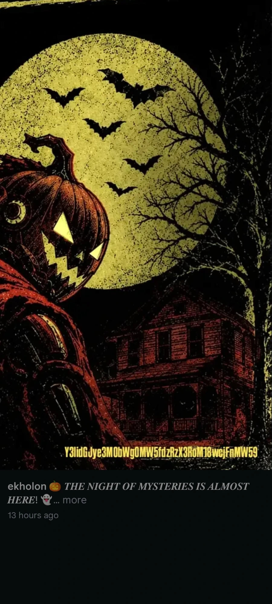

# 🎃 Before the Name — OSINT Writeup

**Category:** OSINT / Social Media
**Flag:** `cybtbr{s4mh41n_w4s_th3_0r1g1n}`

---

## Challenge

> Long before pumpkin Head 🎃 and costumes, an ancient Celtic festival marked the end of harvest. VEIL left the festival's code in a post.
>
> Flag format: `CYBTBR{...}`

No files are given.

---

## Solution

### 1. Identify the festival

| Clue | Meaning |
|------|---------|
| "Long before pumpkin heads and costumes" | Something older than modern Halloween |
| "ancient Celtic festival" | A Gaelic festival |
| "marked the end of harvest" | Held around 31 October – 1 November, the end of the harvest season |
| "Before the Name" | Before it was called Halloween |

This is **Samhain**, the Gaelic festival that Halloween comes from.

### 2. Find the post

"VEIL left the festival's code in a post" points to the event's social media. The organizers' Instagram account, **ekholon**, has a Halloween-themed post captioned "🎃 THE NIGHT OF MYSTERIES IS ALMOST HERE! 👻".



The bottom of the image has a string in yellow text:

```
Y3lidGJye3M0bWg0MW5fdzRzX3RoM18wcjFnMW59
```

### 3. Decode the string

It uses only letters and digits, and `Y3lidGJy` is what `cybtbr` looks like in base64:

```bash
echo -n "Y3lidGJye3M0bWg0MW5fdzRzX3RoM18wcjFnMW59" | base64 -d
```

```
cybtbr{s4mh41n_w4s_th3_0r1g1n}
```

It reads "Samhain was the origin" in leetspeak, which confirms the festival from step 1.

---

## Takeaways

- When a challenge says "in a post", check the event's own social media accounts first.
- Strings that start with `Y3li…` or end in `=` are worth trying as base64. The flag prefix `cybtbr` always encodes to `Y3lidGJy`.
- Text inside an image can't be searched or copied, so type it out carefully: one wrong character breaks the decode.
