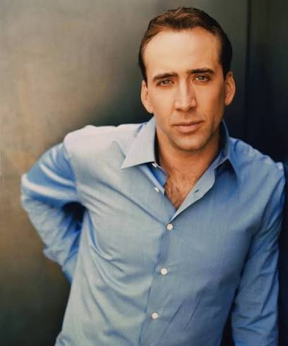

# 🔥 Devil Registration — OSINT Writeup

**Category:** OSINT
**Flag:** `CYBTBR{299_ZXB}`

---

## Challenge

> A rider once travelled under a number that became more than just an identification.
>
> Some say the vehicle belonged to a man who rode through fire itself.
>
> Others believe the number carries a connection to something supernatural.

We are given a single photo of a man.



---

## Solution

### 1. Identify the person

A reverse image search (Google Lens) shows the man in the photo is **Nicolas Cage**.

Cage is well known for playing **Johnny Blaze**, the stunt motorcyclist who becomes the **Ghost Rider**, in *Ghost Rider* (2007) and *Ghost Rider: Spirit of Vengeance* (2011).

### 2. Read the hints

| Hint | Meaning |
|------|---------|
| "A rider once travelled under a number…" | The Ghost Rider, and his vehicle's **registration number** |
| "…a man who rode through fire itself" | The Ghost Rider's flaming vehicle (the Hell Cycle) |
| "…a connection to something supernatural" | The Spirit of Vengeance, a demon bound to the rider |
| Challenge name: "Devil Registration" | The licence plate of the devil's vehicle |

So we need the **licence plate** of a Ghost Rider's vehicle.

### 3. Find the plate

Johnny Blaze's motorcycle in the films has no plate number that stands out. The Ghost Rider whose vehicle has a famous plate appears in Marvel's TV series instead.

In ***Agents of S.H.I.E.L.D.*** (season 4), the Ghost Rider is **Robbie Reyes**, who drives a black **1969 Dodge Charger**, the "Hell Charger". It catches fire when he transforms, just like the Hell Cycle.

Searching for the car's plate (fan wikis, screenshots from the show) gives:

```
299 ZXB
```

### 4. Build the flag

Spaces are not allowed in the flag, so the space becomes an underscore:

```
CYBTBR{299_ZXB}
```

---

## Takeaways

- Reverse image search is the quickest way to identify a well-known face.
- Link the person to the role, then use the role to read the hints. Here Cage led to the Ghost Rider.
- If the obvious source (the films) has no answer, look at other versions of the same character. Here the plate came from the TV series.
- "Registration" in a challenge name usually means a licence plate.
