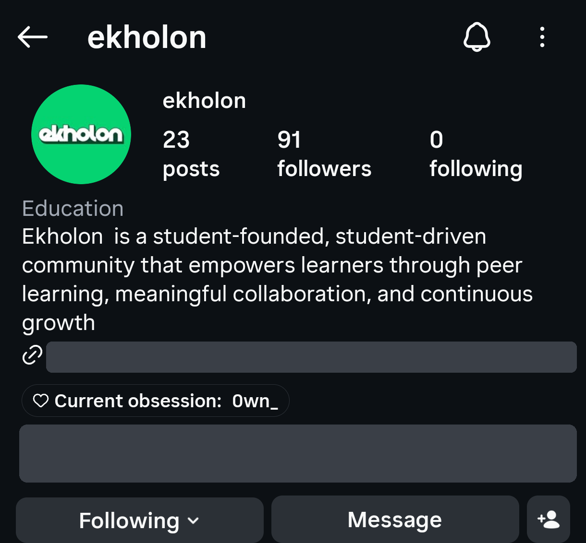
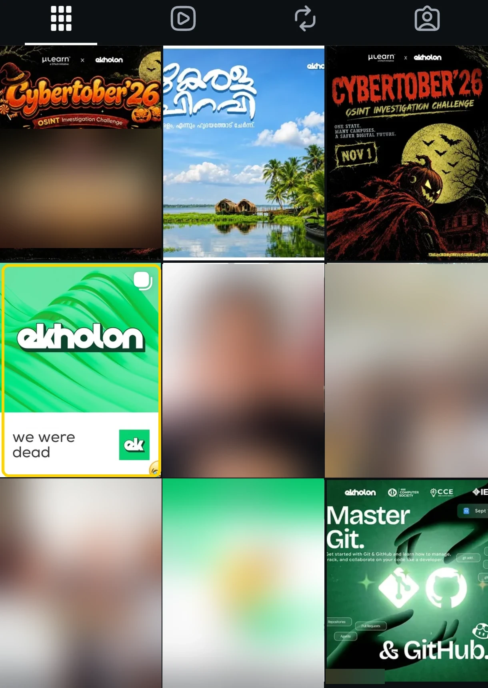
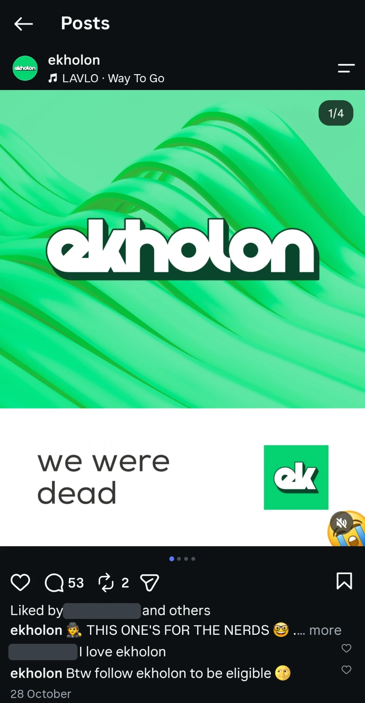
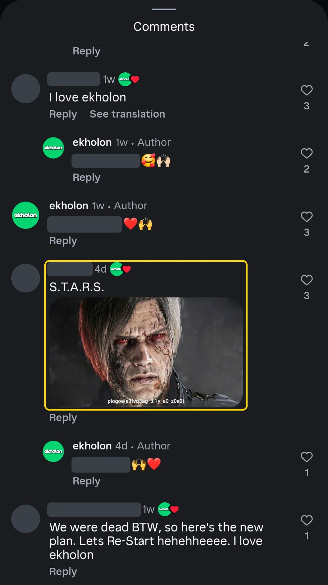
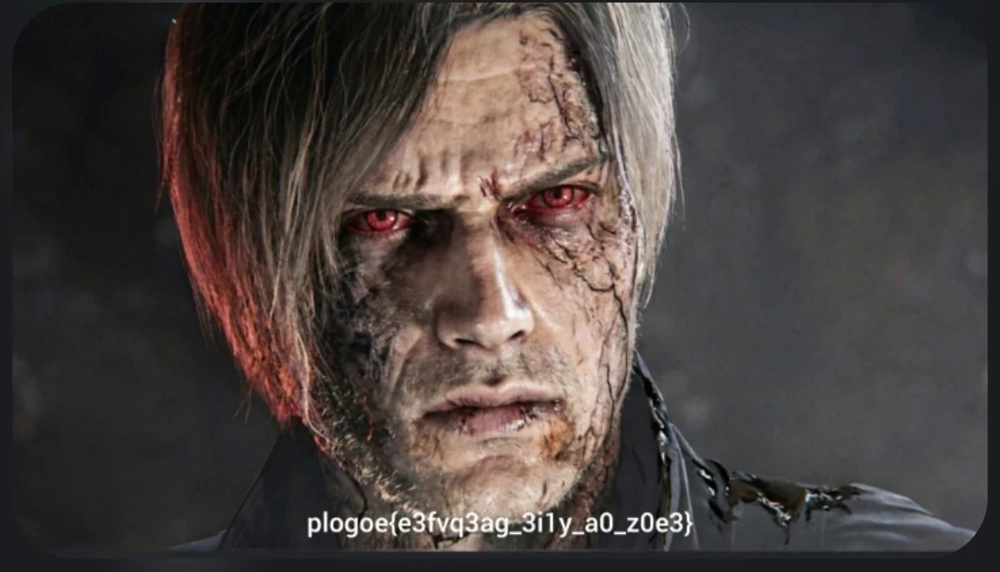

# First Whisper — CYBTBR (Cybertober) CTF Writeup

| | |
|---|---|
| **Event** | CYBTBR (Cybertober) CTF (2026) |
| **Challenge** | First Whisper |
| **Category** | OSINT / Social Media / Crypto |
| **Difficulty** | Medium (300 pts, only 2 solves) |
| **Flag format** | `cybtbr{...}` |

---

## Background

Cybertober'26 was an OSINT investigation challenge run by **µLearn x ekholon**. A lot of its challenges sent you to the organizers' social media, and this one was the "first message" left by VEIL, the event's villain.

## The Challenge

> *Every haunting begins with a whisper. VEIL has left its first message.*
>
> *Something unusual has appeared within a student community's digital presence. A mysterious **S.T.A.R.S. Distress Call** has surfaced, carrying a message that seems out of place among ordinary posts and conversations.*
>
> *Is it a genuine distress signal, or is something trying to communicate?*
>
> *Investigate the S.T.A.R.S. signal, identify the suspicious message hidden within the social media activity, and decipher what it reveals.*
>
> *Sometimes, the smallest whispers reveal the darkest secrets.*

There were no files. The challenge had two hints:

- **"first one"**: *use your mobile phone to view the chall. Lap won't support prolly!*
- **"trade only.... hehe"**: *ROT 13 decrypt by going through social*

## What Made It Tricky

- **S.T.A.R.S.** is the special police unit from *Resident Evil*. That's a theme, not a username or a search term, so it doesn't lead you anywhere directly.
- The message isn't in a post or caption. It's inside a **comment with an image**, and the Instagram website on a laptop doesn't show those properly. That's what the first hint means: you need the phone app.

## The Solution

### Step 1: Find the "student community"

The *student community* is **ekholon**, one of the event's organizers. Its Instagram bio says it is a *"student-founded, student-driven community"*.



*(I blurred the profile link.)*

### Step 2: Find the post that's "out of place"

Most of ekholon's posts are normal event posters (Cybertober'26, Master Git & GitHub and so on). One stands out: a plain green post that just says **"we were dead"**.



*(Unrelated posts are blurred.)*

The caption reads *"THIS ONE'S FOR THE NERDS 🤓"*, which is a pretty strong hint that something is hidden here.



### Step 3: Read the comments on the phone app

The post has 53 comments. Most of them are just "I love ekholon". Scrolling down on the phone, one comment has the text **S.T.A.R.S.** and an image attached. That's the "S.T.A.R.S. Distress Call" from the challenge.



*(I blanked out the commenters' usernames.)*

Another comment nearby says *"We were dead BTW, so here's the new plan. Lets **Re-Start**…"*. "Re" is a nod to **Re**sident Evil.

### Step 4: Open the image

The image is an infected Leon S. Kennedy from *Resident Evil*, with a line of text at the bottom:



```
plogoe{e3fvq3ag_3i1y_a0_z0e3}
```

It's shaped like a flag (`xxxxxx{...}`, with the same 6-letter prefix length as `cybtbr`), but the letters are scrambled.

### Step 5: Decode with ROT13

The digits and the `_` are untouched and only the letters have changed, so this is a simple letter-shift cipher. Checking the prefix:

| Cipher | p | l | o | g | o | e |
|---|---|---|---|---|---|---|
| Plain | c | y | b | t | b | r |
| Shift | 13 | 13 | 13 | 13 | 13 | 13 |

Every letter is shifted by 13, which is **ROT13** (the second hint confirms it). ROT13 is its own inverse, so you apply it again to decode:

```bash
echo "plogoe{e3fvq3ag_3i1y_a0_z0e3}" | tr 'A-Za-z' 'N-ZA-Mn-za-m'
```

```
cybtbr{r3sid3nt_3v1l_n0_m0r3}
```

It reads "Resident Evil no more" in leetspeak, matching the S.T.A.R.S. theme. 🎉

## Flag

```
cybtbr{r3sid3nt_3v1l_n0_m0r3}
```

## What I Learned

1. **Check the comments, not just the posts.** Organizers can hide things in replies, and comments with images are easy to miss.
2. **Use the phone app for Instagram.** The website hides some content, such as images in comments. If a hint says "use your phone", believe it.
3. **Compare the encoded prefix with the known flag prefix.** `plogoe` against `cybtbr` gave the shift (13) right away.
4. **Digits and symbols staying the same means a letter-only cipher.** That points to ROT13 or Caesar, not base64.

---

The first whisper was a zombie Leon all along 🧟
