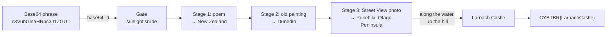
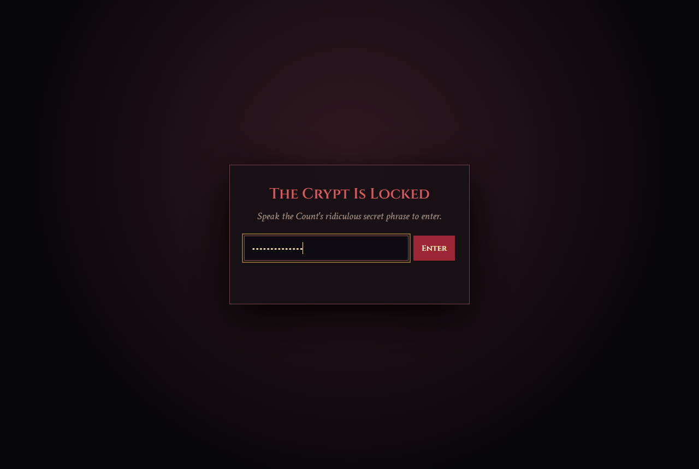
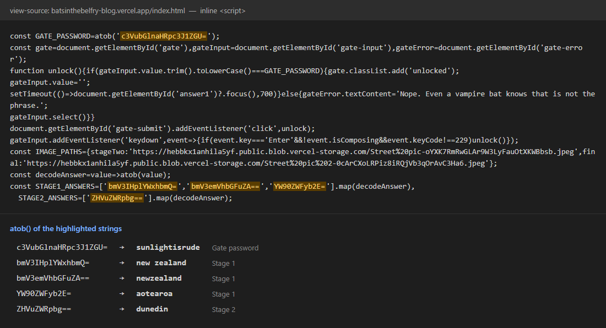
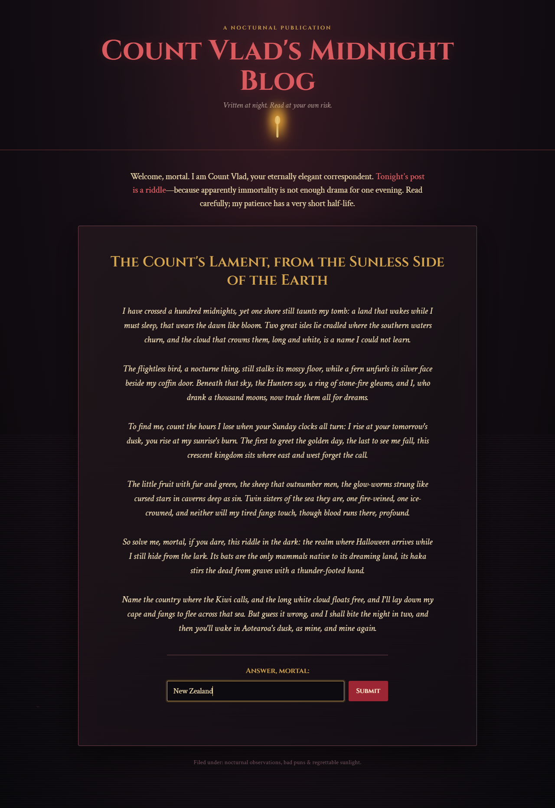
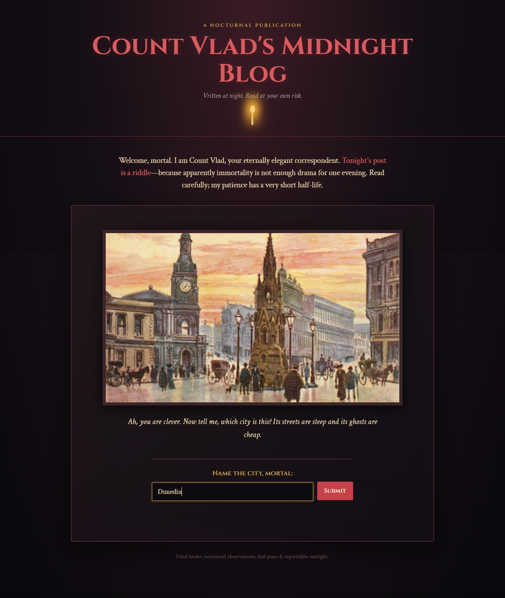
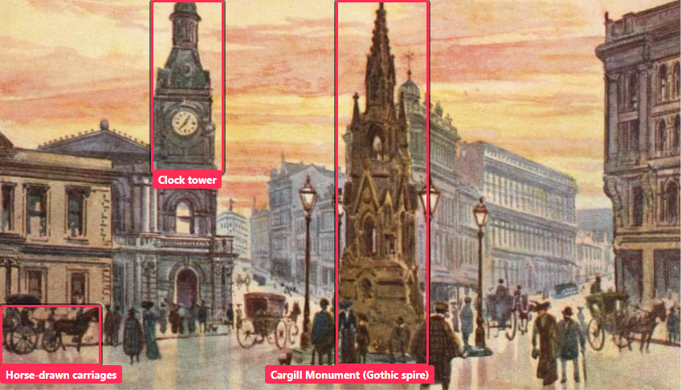
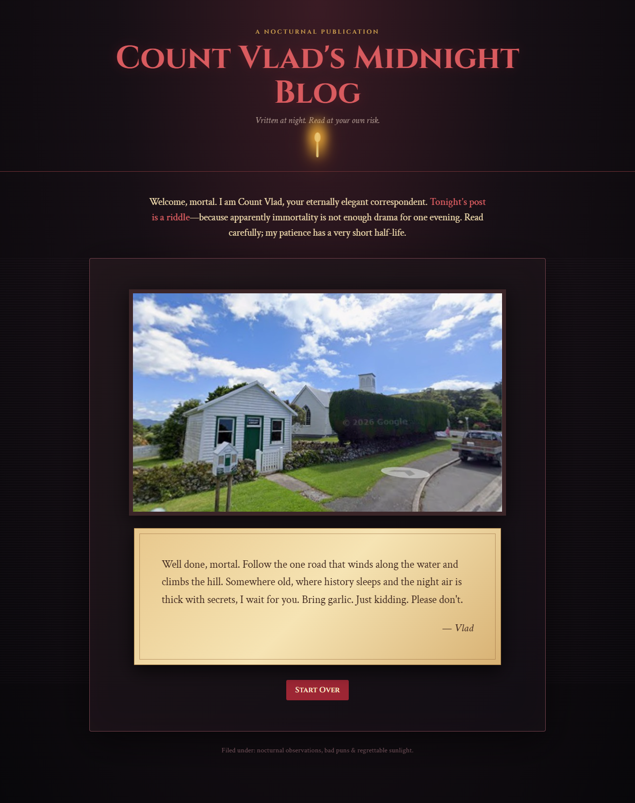
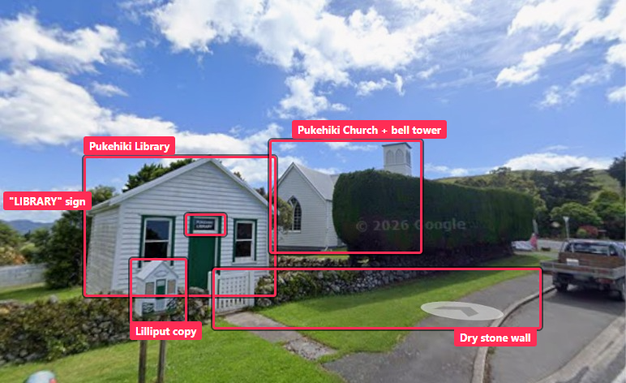
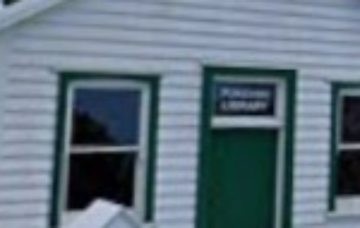

# 🦇 The Count's Forgotten Blog — OSINT Writeup

**Category:** OSINT / Web / Geolocation
**Flag:** `CYBTBR{LarnachCastle}`

---

## Challenge

> Ah, a visitor! How delightfully unfortunate for you. 🦇
>
> I've locked away a little secret in my personal blog. Nothing too frightening, I assure you... well, unless you consider centuries-old secrets, cryptic riddles, and my impeccable sense of humour frightening.
>
> My Blog is not open to just any mortal. You'll need this little phrase to gain entry:
>
> `c3VubGlnaHRpc3J1ZGU=`
>
> Once inside, pay attention to what you read. I have left a few things behind, and unlike my victims, they aren't particularly good at staying buried.
>
> Be warned: I do not appreciate careless visitors.
>
> Enter my blog: <https://batsinthebelfry-blog.vercel.app/>
>
> Your eternal host,
> Count Dracula 🩸
>
> Flag Format: `CYBTBR{...}` (without any spaces)

---

## Solve path at a glance



Each step narrows the location: **country → city → village → landmark**.

| Stage | Input | Answer | Key evidence |
|-------|-------|--------|--------------|
| Gate | Base64 string | `sunlightisrude` | `base64 -d` |
| 1 | Riddle poem | New Zealand | Kiwi, silver fern, "long white cloud", haka |
| 2 | Old street painting | Dunedin | Cargill Monument in The Exchange |
| 3 | Street View photo + note | Larnach Castle | Pukehiki Library + church, "climbs the hill", "somewhere old" |

---

## Solution

### 1. Decode the entry phrase

The `=` padding gives it away as Base64:

```bash
echo c3VubGlnaHRpc3J1ZGU= | base64 -d
# sunlightisrude
```

Password: **`sunlightisrude`**



### 2. Look at the site

The root page is a Next.js shell that only loads an iframe:

```html
<iframe src="/index.html" title="Count Vlad's Midnight Blog" ...>
```

So the real blog is at `/index.html`:

```bash
curl -s https://batsinthebelfry-blog.vercel.app/index.html -o blog.html
```

It is one static page with a password gate and three stages. Each stage stays hidden until you answer the one before it.

All the checks run in the browser, and the answers are in the page source, only Base64-encoded:



```js
const GATE_PASSWORD=atob('c3VubGlnaHRpc3J1ZGU=');
const STAGE1_ANSWERS=['bmV3IHplYWxhbmQ=','bmV3emVhbGFuZA==','YW90ZWFyb2E='].map(decodeAnswer),
      STAGE2_ANSWERS=['ZHVuZWRpbg=='].map(decodeAnswer);
```

| Base64 | Decoded |
|--------|---------|
| `bmV3IHplYWxhbmQ=` | new zealand |
| `bmV3emVhbGFuZA==` | newzealand |
| `YW90ZWFyb2E=` | aotearoa |
| `ZHVuZWRpbg==` | dunedin |

The source also has the image URLs for every stage (`IMAGE_PATHS`), so we can see the whole challenge without clicking through it. Each stage can still be solved from its clues, though:

### 3. Stage 1 — the poem (country)



*"The Count's Lament, from the Sunless Side of the Earth"*

| Clue | Meaning |
|------|---------|
| "Two great isles … where the southern waters churn" | North Island and South Island |
| "the cloud that crowns them, long and white" | *Aotearoa*, "land of the long white cloud" |
| "The flightless bird … a fern unfurls its silver face" | Kiwi and silver fern |
| "the first to greet the golden day" | One of the first countries to see each new day |
| "The little fruit with fur and green, the sheep that outnumber men" | Kiwifruit, sheep |
| "glow-worms strung like cursed stars in caverns" | Waitomo glow-worm caves |
| "Its bats are the only mammals native to its dreaming land" | NZ's only native land mammals are bats |
| "its haka stirs the dead" | Māori haka |

Answer: **New Zealand**

### 4. Stage 2 — the old street painting (city)



> *"Which city is this? Its streets are steep and its ghosts are cheap."*



- The tall Gothic spire in the middle is the **Cargill Monument**, which stood in **The Exchange** (Princes Street), Dunedin's old commercial centre.
- Victorian/Edwardian stone buildings, horse-drawn carriages, and a clock tower match old postcards of Dunedin.
- "Steep streets": Dunedin has **Baldwin Street**, once listed as the world's steepest street.

Answer: **Dunedin**

### 5. Stage 3 — the final clue (location)



The note under the photo:

> *"Well done, mortal. Follow the one road that winds along the water and climbs the hill. Somewhere old, where history sleeps and the night air is thick with secrets, I wait for you. Bring garlic. Just kidding. Please don't."* — Vlad

There is no hidden data in the image file (I checked with `strings` and found no EXIF or embedded text). The answer comes from geolocating the photo.



| Detail | What it tells us |
|--------|------------------|
| Small white weatherboard cottage with a green door | A small heritage building |
| Sign above the door reads **LIBRARY** (see zoom below) | It's a library |
| A tiny copy of the same cottage on a post in front | A "Lilliput" (little free) library |
| Dry stone wall and white picket gate | Rural Otago style |
| White wooden church with a square bell tower behind | An early settler church |



This is **Pukehiki Library**, next to **Pukehiki Church** on the Otago Peninsula in Dunedin. The library (built in 1908) is described on the [Pukehiki community site](https://pukehiki.nz/library.html), and the church in [A Peek at Pukehiki Church](https://adventure.nunn.nz/?p=6173).

Now the note:

| Clue | Meaning |
|------|---------|
| "the one road that winds along the water" | The Otago Peninsula road along Otago Harbour |
| "and climbs the hill" | Up the hill to Pukehiki |
| "Somewhere old, where history sleeps" | **Larnach Castle**, built in 1871, just next to Pukehiki. It is often called New Zealand's only castle |
| "the night air is thick with secrets" | The castle is known for its ghost stories, a good lair for a vampire |

How the places fit together (simplified, not to scale):

```
                       OTAGO PENINSULA
                ┌───────────────────────────────────────┐
                │        [ Larnach Castle ] ★ (flag)    │
                │              ▲                        │
                │              │ short hop on the hill  │
                │        [ Pukehiki ] ← Stage 3 photo   │
                │     library + church                  │
                │         ▲   (hilltop)                 │
                │         │ road climbs the hill        │
   [ Dunedin ] ─┴─────────┴─ road winds along the water ┘
   Stage 2 city    ~~~~~~~~~ Otago Harbour ~~~~~~~~~
```

Answer: **Larnach Castle**

### 6. Build the flag

The format asks for no spaces:

```
CYBTBR{LarnachCastle}
```

---

## Takeaways

- Read the page source. All the checks ran in the browser, and every answer was only Base64-encoded, which hides nothing.
- When a site is just a shell around an iframe, go straight to the iframe's `src`.
- Landmarks solve old paintings and postcards quickly. One monument (Cargill Monument) was enough to name the city.
- For the final step, the photo gives you the starting point (Pukehiki) and the text tells you where to go from there (along the water and up the hill to the castle).

---

### Files

| File | What it is |
|------|------------|
| `cfb_01_gate.png` | Password gate with the decoded phrase entered |
| `cfb_02_stage1.png` | Stage 1 poem with the answer |
| `cfb_03_stage2.png` | Stage 2 painting with the answer |
| `cfb_04_stage3.png` | Stage 3 photo and final note |
| `cfb_05_source.png` | Answer-check script from the page source, decoded |
| `cfb_06_stage2_annotated.png` | Stage 2 painting with landmarks marked |
| `cfb_07_stage3_annotated.png` | Stage 3 photo with details marked |
| `cfb_08_library_zoom.png` | Zoom on the "LIBRARY" sign |
| `cfb_stage2_original.jpg`, `cfb_stage3_original.jpg` | The original challenge images |
