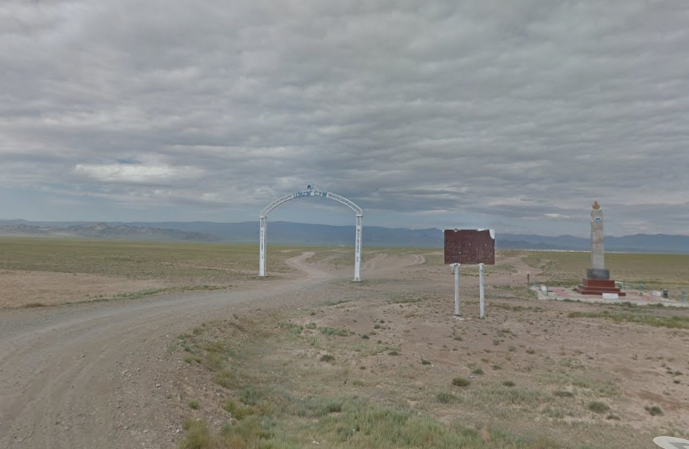
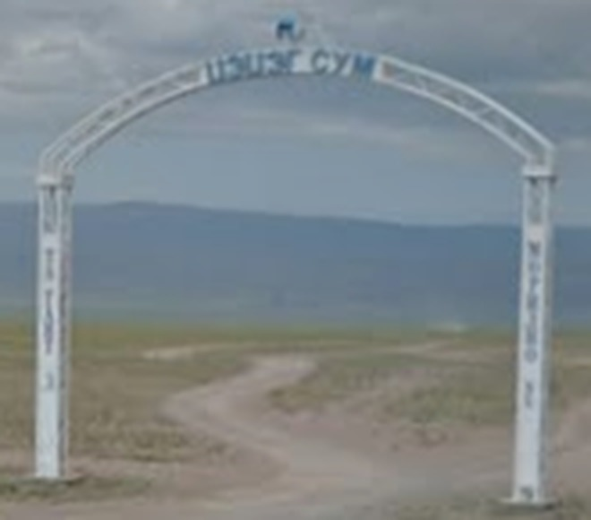
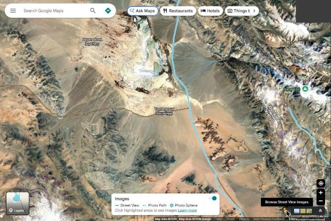
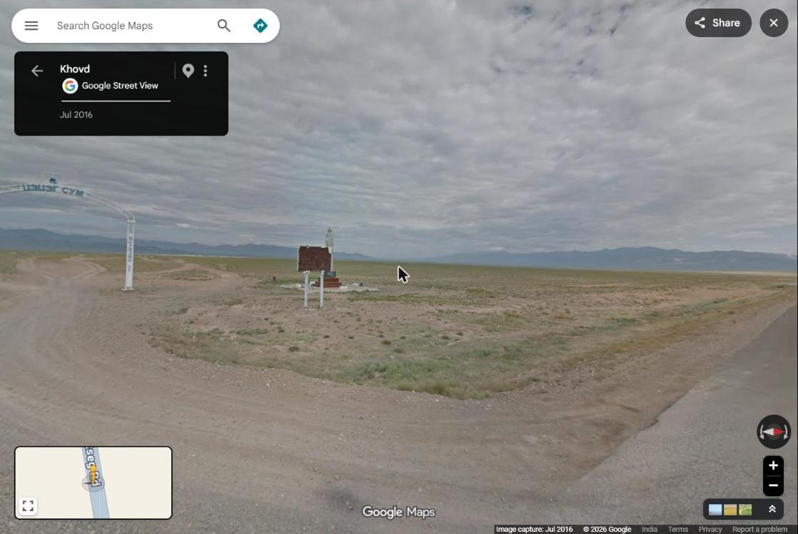

# 🗺️ The Forgotten Crossing — OSINT Writeup

**Category:** OSINT / Geolocation
**Flag:** `CYBTBR{46.59,93.33}`

---

## Challenge

> Somewhere along a forgotten road, a silent marker stands beneath an endless sky.
> No directions. No names. Just a place waiting to be found.
>
> Can you figure out where this photograph was taken?
>
> **Flag Format:** `CYBTBR{latitude,longitude}`
>
> Submit the coordinates in decimal degrees, rounded to exactly two decimal places.

We are given one image, `the_last_checkpoint.jpg` (actually a PNG, 969×632, with no metadata):



---

## Solution

### 1. Read the scene

| Detail | What it tells us |
|--------|------------------|
| Endless flat steppe, low dry grass, distant bare mountains | Central Asian steppe |
| White metal arch over a dirt track, with Cyrillic text | A **soum (district) entrance arch**, typical of **Mongolia** |
| White stele on a red base, topped with a flame/Soyombo symbol | A soum monument, also typically Mongolian |
| Billboard frame and gravel turn-off | The arch marks a side road leaving a main highway |
| Low-resolution, washed-out look | A Google Street View capture |

### 2. Read the arch

Zooming in on the top of the arch:



The blurry text reads **"ЦЭЦЭГ СУМ"** (*Tsetseg sum*), meaning Tsetseg district. Tsetseg is a soum in **Khovd Province**, western Mongolia. Its village, Tsetsegnuur, is at about **46.59°N, 93.27°E**.

Submitting the village centre (`46.59,93.27`) is **wrong**. Entrance arches stand where the village road leaves the highway, which can be several kilometres from the village itself.

### 3. Use Street View coverage

Since the image is a Street View capture, the arch must be on a road Google has driven. In Google Maps, turning on the Street View layer (the pegman button) shows coverage around Tsetseg:



Only the main north–south highway, the blue line, is covered. The village road is not. So the arch must stand where the road to Tsetsegnuur leaves that highway, just east of the village.

### 4. Find the arch

Dropping into Street View at that junction (imagery from July 2016) and turning west shows the same arch, billboard and monument:



The panorama is at **46.5936°N, 93.3267°E**.

### 5. Build the flag

Rounded to two decimal places:

```
CYBTBR{46.59,93.33}
```

---

## Takeaways

- A soum entrance arch plus a monument by a gravel road is a strong Mongolia clue, and the arch usually names the soum.
- A place's "official" coordinates (the village centre) are not where the photo was taken. Entrance markers sit on the access road, often kilometres away.
- If a photo is a Street View capture, use the **coverage layer**. In sparse regions like rural Mongolia, it leaves only one or two roads to check.
- With two-decimal precision, about 1 km, being off by a few km fails. Check the exact spot before submitting.
