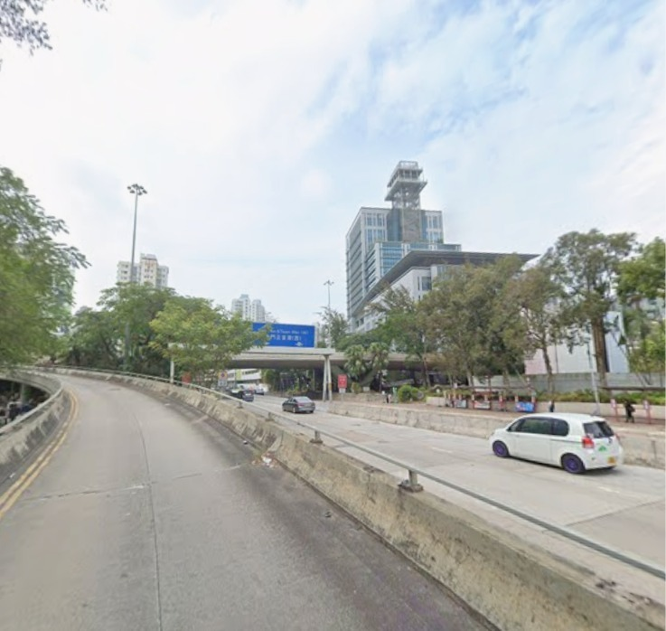
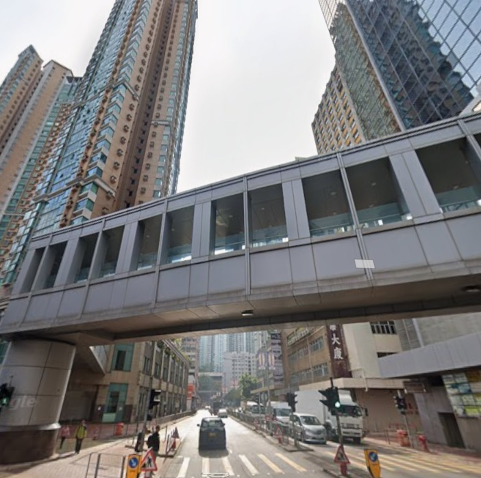
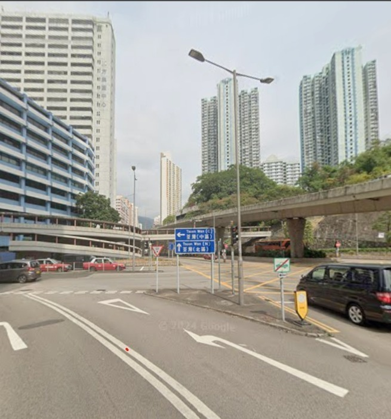
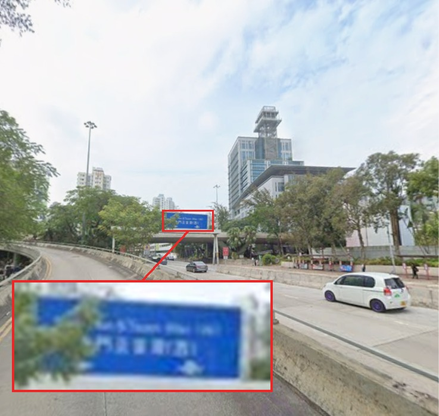
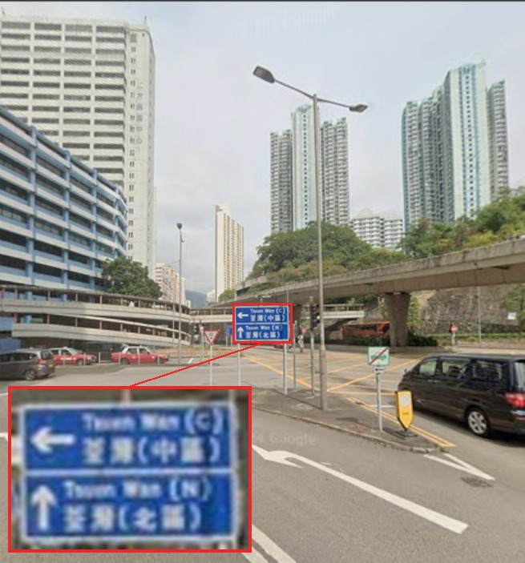
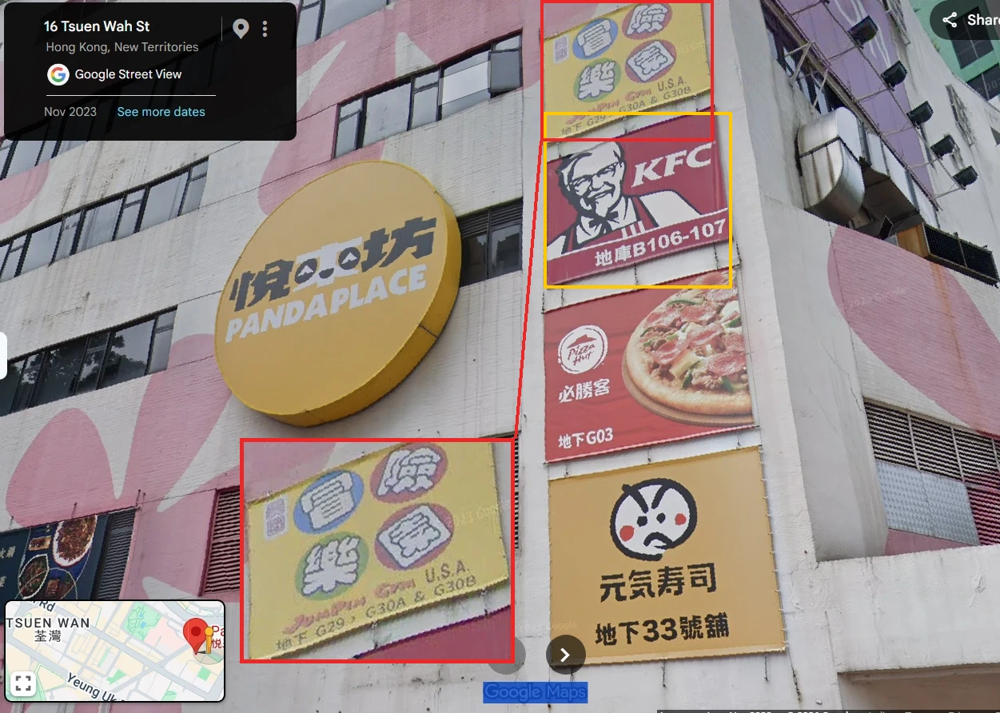
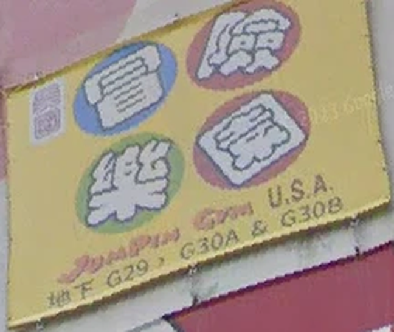

# The Hidden Gym Code — CYBTBR (Cybertober) CTF Writeup

| | |
|---|---|
| **Event** | CYBTBR (Cybertober) CTF (2026) |
| **Challenge** | The Hidden Gym Code |
| **Category** | OSINT / Geolocation |
| **Difficulty** | Hard (300 pts, only 4 solves) |
| **Flag format** | `CYBTBR{letternumberletter}` |

---

## Background

This was one of the geolocation challenges in Cybertober'26. You get three street photos and have to find one specific gym poster somewhere in a big city. I narrowed down the area myself, but I couldn't get the last step working, and a friend found the building in the end.

## The Challenge

> *A strange lead has emerged from the crowded streets of a city where countless secrets hide in plain sight.*
>
> *Somewhere within a 3-kilometre radius of a particular garden lies a **building whose identity is tied to an animal**. But finding the building is only the beginning.*
>
> *VEIL has left behind several visual traces. Among them are photographs capturing fragments of the surrounding streets, commercial signs, and details that may seem insignificant at first.*
>
> *One particular **advertisement** may lead you closer to the truth. Look beyond it. Somewhere **above**, a **gym poster** holds the information you seek.*
>
> *Identify the establishment, examine its signage, and uncover the **three unit numbers** associated with it.*
>
> *Flag Format: `CYBTBR{letternumberletter}`*

We're given three photos:

| Photo 1 | Photo 2 | Photo 3 |
|---|---|---|
|  |  |  |

## What I Tried First

- **Metadata:** nothing. The photos have no GPS or camera data. They're screenshots from Google Street View, and photo 3 still has a "© 2024 Google" watermark.
- **Guessing the animal building:** once I knew the city, I tried buildings with animals in their names, like Golden Bear Industrial Centre (金熊工業中心) in Tsuen Wan and Golden Dragon Industrial Centre (金龍工業中心) in Kwai Fong. Neither had a gym that matched.
- **Walking around in Street View:** this is the step the challenge really needs, but Street View wouldn't load properly on the setup I was using, so I couldn't check the streets myself.

## The Solution

### Step 1: Find the city from the road signs

Everything in the photos (red taxis, left-hand traffic, bilingual signs in English and Traditional Chinese) says **Hong Kong**. The road signs narrow it down further.

Photo 1 has a sign for **"Tuen Mun & Tsuen Wan (W) / 屯門及荃灣(西)"**:



Photo 3 has a sign pointing left to **"Tsuen Wan (C) / 荃灣(中區)"** and straight on to **"Tsuen Wan (N) / 荃灣(北區)"**:



So we're in or right next to **Tsuen Wan**, in the New Territories.

*(The red box marks the sign, and the inset is a zoomed-in snip of it. The challenge photos are low-resolution, so the zoom is a bit blurry, but the district names are readable.)*

### Step 2: Find the "building tied to an animal"

The key building is **Panda Place (悅來坊)** at **16 Tsuen Wah Street, Tsuen Wan**. The animal is right there in the English name, and the logo has a little panda face in it.

How to get there from the photos:

1. The signs put you in **Tsuen Wan**, so search Google Maps there for building names with animals in them. **Panda** Place (next to the Panda Hotel) stands out straight away.
2. Drop into **Street View** around Panda Place and look at the outside of the building for advertisements.
3. Use the **older imagery**. The gym has since moved: Google Maps now lists Jumpin Gym U.S.A. at Nina Mall 2 instead. So searching "gym" today won't lead you to Panda Place, and newer Street View may not show the poster. The screenshot below is from **Nov 2023**, and you can switch dates with "See more dates" in Street View.

My friend found it this way. The screenshot below is theirs, and I added the boxes and the zoom:



### Step 3: Find the advertisement, then look above it

The side of the building is covered in restaurant ads. In the screenshot above, the **KFC** banner (yellow box) is the obvious "advertisement". Following the hint to *look above it*, the top banner (red box, zoomed in on the left) is the gym poster.

Zoomed in all the way:



> **JumPin Gym U.S.A.**, 地下 **G29、G30A & G30B**

地下 means "ground floor", and **G29, G30A and G30B** are the gym's three unit numbers, the ones the challenge asks for.

### Step 4: Match the flag format

The format is `letternumberletter`, so G29 is out because it doesn't end in a letter. G30A and G30B both fit, and **G30A** (the first one listed on the poster) is the accepted flag:

| Unit | Pattern | Fits the format? |
|---|---|---|
| G29 | letter + number | ❌ |
| G30A | letter + number + letter | ✅ accepted |
| G30B | letter + number + letter | ✅ but not the flag |

## Flag

```
CYBTBR{G30A}
```

## What I Learned

1. **Road signs are a geolocation goldmine.** The district names on the direction signs took me from "somewhere in Asia" to one neighbourhood of Hong Kong.
2. **"Tied to an animal" can mean the name.** I was looking for animal statues or logos, but the answer was a building literally called *Panda* Place.
3. **Follow the hint's directions literally.** "Find the advertisement, look above it" was exact: the gym poster sits directly above the KFC banner.
4. **Use the flag format to narrow it down.** The poster listed three units, and the `letternumberletter` format ruled out G29 straight away.
5. **Check older Street View dates.** Shops move and posters come down. If the current imagery doesn't match, go back in time with "See more dates".
6. **Get a second pair of eyes.** I got stuck on the last step, and a friend's Street View search cracked it. OSINT is a team sport sometimes.

---

Thanks to my friend for finding the panda 🐼
