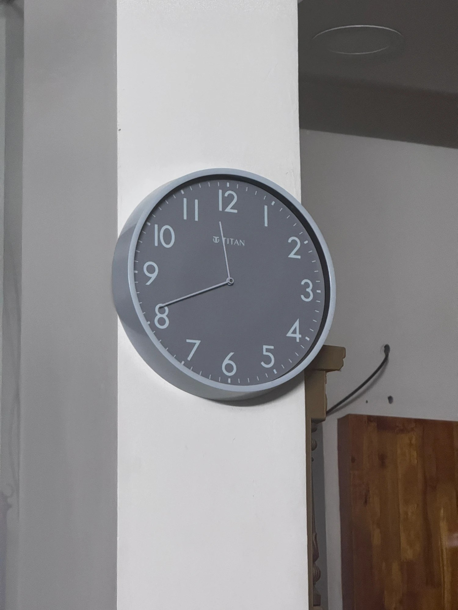
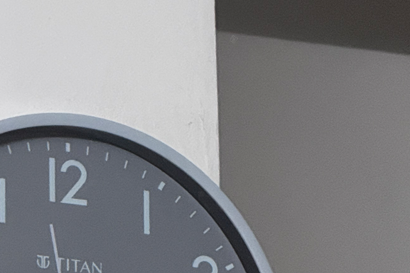
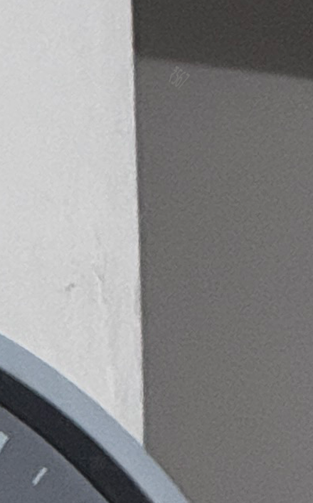
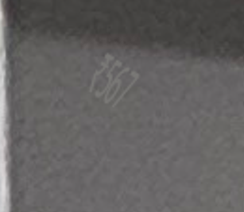

# ⏰ The Hidden Prize — OSINT Writeup

**Category:** OSINT / Image Analysis
**Flag:** `CYBTBR{₹567}`

---

## Challenge

> An image can tell a thousand stories, but sometimes, the most important detail is the one nobody notices.
>
> Not every secret is hidden in the settings
>
> Look closer. Think deeper. Examine what others overlook.
>
> find me the price
>
> Flag Format: `CYBTBR{₹XXX}`

We are given a photo of a wall clock:



---

## Solution

### 1. Read the hints

| Hint | What it tells us |
|------|------------------|
| *"Not every secret is hidden in the settings"* | Don't expect the answer in the file's metadata (EXIF, camera settings) |
| *"Look closer … Examine what others overlook"* | The answer is visible in the picture itself |
| `CYBTBR{₹XXX}` | The price is a **3-digit** number in rupees |

### 2. Rule out the metadata

Checking the image's metadata confirms the hint: there is no EXIF or XMP data, no comment and no camera information. Nothing is hidden in the settings.

### 3. Look at the picture

The clock is a **Titan** wall clock. It's tempting to go and search for the price of this model online, but the challenge says the answer is in the picture.

Everyone looks at the clock, so the trick is to look *around* it. Zooming into the top-right of the photo, just above the clock, there's a dark wall behind the white pillar:



Zooming further into that corner, there's something tiny written on the wall, right under the ceiling shadow:



Zooming in all the way, it reads **₹567**:



It's three digits with a rupee sign, which matches the `₹XXX` format exactly. So the "price" is **₹567**.

### 4. Build the flag

```
CYBTBR{₹567}
```

---

## Takeaways

- Read the hints literally. *"Not in the settings"* meant "skip the metadata", and *"what others overlook"* meant the answer is in plain sight.
- The flag format can help. `₹XXX` said exactly three digits, which narrowed things down a lot.
- Don't overthink it. Searching for the clock's real price online was a rabbit hole. The answer was hidden in the photo itself.
- Look away from the main subject. The clock grabs your attention, but the price was written in tiny text on the wall behind it. Zoom into every corner.
