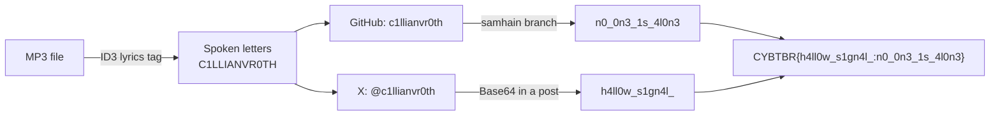

# 📡 The Last Transmission — OSINT Writeup

**Category:** OSINT / Audio / Social Media
**Flag:** `CYBTBR{h4ll0w_s1gn4l_:n0_0n3_1s_4l0n3}`

---

## Challenge

> At 3:07 AM on Halloween, someone vanished without a trace. Their digital presence, however, remains active. Listen carefully to the transmission, follow the clues to their online accounts, and recover two hidden fragments scattered across social media pages.
>
> Flag Format: `CYBTBR{firstflag:secondflag}`

We are given one file, `The_Fragmented_Cipher_audio.mp3` (about 4.5 minutes).

---

## Solve path at a glance



---

## Solution

### 1. Read the MP3's tags

The song was made with Suno, and its full lyrics are stored in the file's ID3 `USLT` (lyrics) frame as plain text, so no listening is needed:

```bash
strings -n 6 The_Fragmented_Cipher_audio.mp3 | head -80
```

```
Title: The Fragmented Cipher
...
Terminal active. Logging character string. "C"
[Verse 1]
...
[Spoken Robotic Voice]
"one"
...
[Spoken Robotic Voice]
"L"
...
String compiled. Target identified.
Happy Cybertober.
```

The lyrics alternate with `[Spoken Robotic Voice]` lines, each giving one character:

| # | Spoken | Character |
|---|--------|-----------|
| 1 | "C" | `C` |
| 2 | "one" | `1` |
| 3 | "L" | `L` |
| 4 | "L" | `L` |
| 5 | "I" | `I` |
| 6 | "A" | `A` |
| 7 | "N" | `N` |
| 8 | "V" | `V` |
| 9 | "R" | `R` |
| 10 | "Zero" | `0` |
| 11 | "T" | `T` |
| 12 | "H" | `H` |

Joined: **`C1LLIANVR0TH`**, a leetspeak username for "Cillian Vroth". The outro line "String compiled. Target identified." confirms it is a handle.

### 2. Find the accounts

Checking the username on common sites finds two accounts made for the challenge:

| Platform | Account | Bio |
|----------|---------|-----|
| GitHub | `c1llianvr0th` | "sysadmin. night shift. i don't log off, i log in. // last seen: 10.31.██ …" |
| X | `@c1llianvr0th` | Same bio |

### 3. Fragment from GitHub

The only repo, `hollowmere-monitor-`, is a fake server-monitoring project full of horror lore (rack 13, 03:07, "3 beats, then 7"). Its README hints:

> Historical infrastructure records may exist in other branches.

The repo has three branches: `main`, `develop` and `samhain`.

```bash
git clone https://github.com/c1llianvr0th/hollowmere-monitor-.git
cd hollowmere-monitor-
git branch -a
git checkout samhain
cat rack13/dump.log
```

`rack13/dump.log` on the `samhain` branch contains:

```
[03:07:02] unique payload=bjBfMG4zXzFzXzRsMG4z
```

```bash
echo bjBfMG4zXzFzXzRsMG4z | base64 -d
# n0_0n3_1s_4l0n3
```

Fragment: **`n0_0n3_1s_4l0n3`** ("no one is alone").

**Decoy:** the `develop` branch has `docs/INCIDENT-2019.md` with a "recovered passphrase", `h4ll0w_s1gn4l_c4m3_b4ck`. The report itself says it was rejected ("ACCESS DENIED"), and it is not the flag fragment. It does share its start with the real second fragment, though.

### 4. Fragment from X

The X account's visible posts keep the theme ("they say samhain is when the veil is thin", "if you're reading my repo: don't checkout what you can't close") and point back to the repo's branches. Logged out, X shows only 5 of the account's 9 posts. The remaining fragment was in a post visible only when logged in, as a Base64 string:

```bash
echo aDRsbDB3X3MxZ240bF8= | base64 -d
# h4ll0w_s1gn4l_
```

Fragment: **`h4ll0w_s1gn4l_`**, including the trailing underscore.

### 5. Build the flag

The format is `CYBTBR{firstflag:secondflag}`. The X fragment comes first, and the trailing underscore is part of it:

```
CYBTBR{h4ll0w_s1gn4l_:n0_0n3_1s_4l0n3}
```

---

## Takeaways

- Check audio metadata before listening. Here the lyrics tag spelled out the whole username.
- Leetspeak usernames (`1` for I/i, `0` for O) are common. Try the exact spelling on several platforms.
- On GitHub, look at **all branches**, not just the default one. The README even said so.
- Watch for decoys. A "recovered passphrase" that the story itself calls wrong is a red flag.
- Some social sites hide posts from logged-out visitors. If a profile shows fewer posts than its count, log in.
- Keep fragments exactly as decoded. The trailing underscore in `h4ll0w_s1gn4l_` was required.
