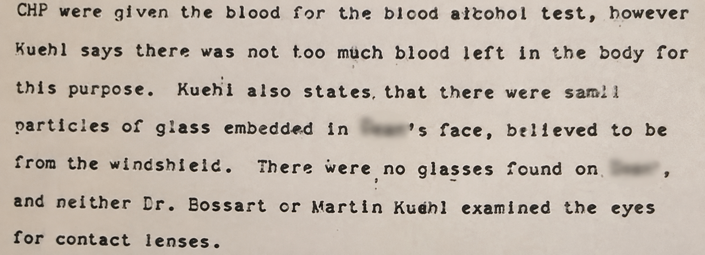

# 🚗 The Last Witness — OSINT Writeup

**Category:** OSINT
**Flag:** `CYBTBR{2Z77767}`

---

## Challenge

> Some incidents are never truly buried. Their evidence fades, witnesses disappear, and the truth becomes another forgotten whisper.
>
> Deep within VEIL's recovered archives lies a fragment of an old investigation report. Its typewritten words speak of blood, shattered glass, unanswered questions, and details that were never fully examined.
>
> A name has been erased. The evidence remains incomplete. But one overlooked detail may lead to something that has escaped attention for decades.
>
> Follow the remnants of this forgotten incident. Reconstruct what happened, trace the evidence, and uncover the registration number of the vehicle connected to it.
>
> One incident. A thousand unanswered questions. One vehicle that must not be forgotten.
>
> `CYBTBR{vehicle_number}`

We are given one image, `discovery.png`:



---

## Solution

### 1. Check the file

The PNG has no hidden text and nothing appended after the image data. Its only metadata is a C2PA content-credentials block showing the image was created digitally, so the "scan" was recreated for the challenge. Everything we need is in the text.

### 2. Read the report

The fragment says:

> CHP were given the blood for the blood alcohol test, however Kuehl says there was not too much blood left in the body for this purpose. Kuehl also states that there were small particles of glass embedded in ████'s face, believed to be from the windshield. There were no glasses found on ████, and neither Dr. Bossart or Martin Kuehl examined the eyes for contact lenses.

| Clue | Meaning |
|------|---------|
| **CHP** | California Highway Patrol, so the crash was in California |
| **Martin Kuehl** | The Paso Robles funeral director who received the body |
| **Dr. Bossart** | The doctor named in the same investigation |
| "no glasses found", "contact lenses" | The victim was known to need glasses |
| Blurred name, 4 letters, followed by `'s` | Fits **Dean** |

These names come from the investigation into **James Dean's** death. He died on **30 September 1955** near Cholame, California, when his Porsche collided with a Ford driven by Donald Turnupseed. The question of whether Dean was wearing his glasses is one of the open questions about the crash.

### 3. Identify the vehicle

"One vehicle that must not be forgotten" is Dean's **Porsche 550 Spyder**, nicknamed **"Little Bastard"**. The wreck became the subject of a "curse" legend, and the car later disappeared.

| Identifier | Value |
|------------|-------|
| Chassis number | 550-0055 |
| California registration (licence plate) | **2Z77767** |

The challenge asks for the **registration number**, so the answer is the plate, not the chassis number.

### 4. Build the flag

```
CYBTBR{2Z77767}
```

---

## Takeaways

- Names in a document (here a funeral director and a doctor) can identify a famous case even when the main name is blurred.
- Count the letters of a redacted name and check it against your guess.
- Read the flag wording carefully: "registration number" means the plate, not the chassis or engine number.
