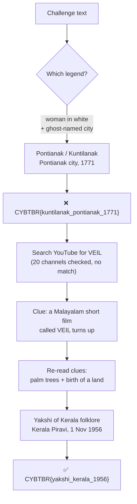
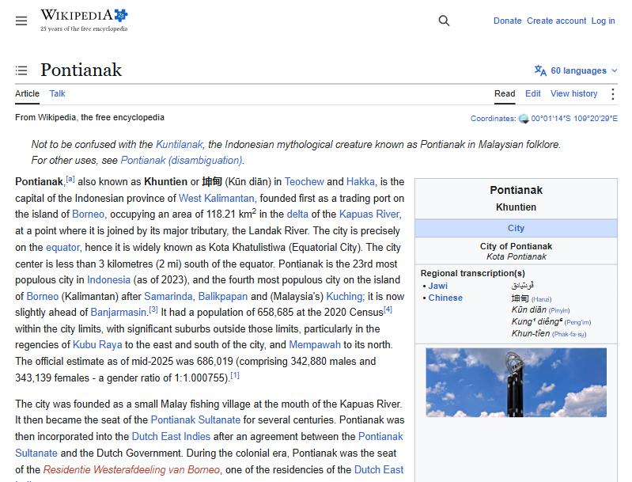
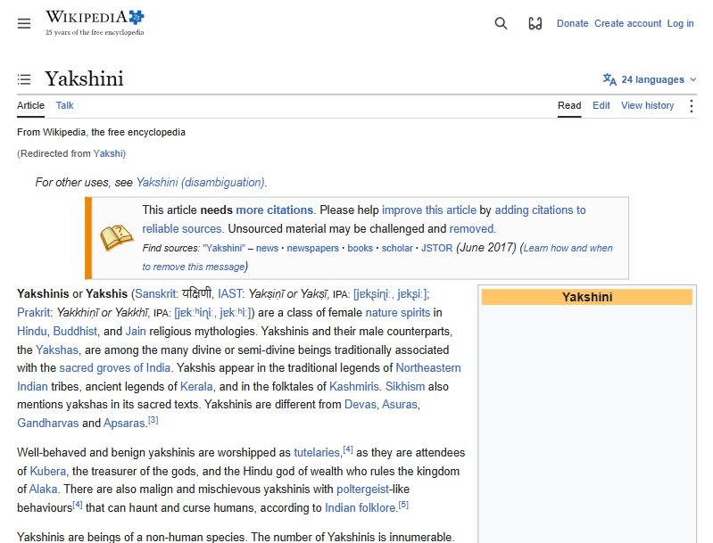
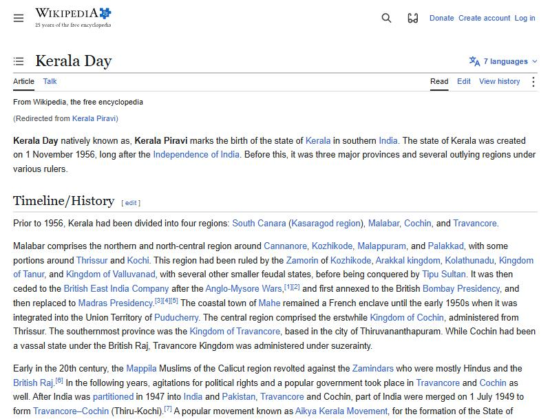

# 🌴 The Night The Land Was Born — OSINT Writeup

**Category:** OSINT / Folklore
**Flag:** `CYBTBR{yakshi_kerala_1956}`

---

## Challenge

> Some nights mark the birth of a land. Others awaken something forgotten.
>
> A mysterious presence emerges from the shadows of an old legend. Whispers speak of a pale woman in white, strange encounters beneath lonely palm trees, and a story buried deep within the past.
>
> VEIL has left a fragment of this tale hidden within a video streaming platform. Follow the digital trail, uncover the forgotten legend, and identify the land and the year connected to its birth.
>
> Two missing pieces. One forgotten legend. Can you uncover the truth?
>
> Flag Format: `CYBTBR{spirit_land_year}`

---

## Solve path at a glance



| Flag piece | Clue in the text | Answer |
|------------|------------------|--------|
| `spirit` | "pale woman in white", "beneath lonely palm trees" | **Yakshi** |
| `land` | "the birth of a land" | **Kerala** (Kerala Piravi = "birth of Kerala") |
| `year` | "the year connected to its birth" | **1956** (Kerala formed 1 Nov 1956) |

---

## Solution

### 1. First guess: Pontianak (wrong)

"A pale woman in white" is the classic description of the **Pontianak** (Malaysia) or **Kuntilanak** (Indonesia), the ghost of a woman who died in childbirth. The story also seemed to explain "the birth of a land":

- **Pontianak** is a real city in West Kalimantan, Indonesia, named after the ghost.
- Legend says its founder, Syarif Abdurrahman Alkadrie, fired cannons to drive the ghosts away before building the city.
- The city's founding date is **23 October 1771**.



That gave the first submission:

```
CYBTBR{kuntilanak_pontianak_1771}   ❌ incorrect
```

**Why it failed:** it fit "woman in white" and "birth", but it ignored the most specific clue. The Pontianak is tied to **banana trees**, not **palm trees**. "Woman in white" alone fits ghosts in a dozen countries, so it was too general to anchor the answer.

### 2. Hunting for VEIL's video (dead end)

The challenge says VEIL hid a fragment "within a video streaming platform", so the next step was YouTube.


Searching for `CYBTBR`, `VEIL CYBTBR` and `VEIL ctf` returned about 20 channels named "Veil" / "VEIL" / "V E I L". Pulling their Shorts and video lists through YouTube's page data turned up mystery and history channels (Jatinga, D. B. Cooper, Flannan Isles, the Somerton Man), but **none had a video about a woman in white or palm trees**.

| Search | Result |
|--------|--------|
| `CYBTBR` | Unrelated videos only |
| `VEIL CYBTBR`, `VEIL ctf` | ~20 "Veil" channels, no matching legend |
| `@veil` | Music videos, plus **"VEIL PART 1 – Malayalam Short Film"** |

The challenge's own video was never found. One result still helped:


Its description shows it is a drama about domestic violence, not the legend, so it is **not** the challenge's video. But *Malayalam* is the language of **Kerala**, which pointed to the right region.

### 3. Re-reading the clues: Yakshi of Kerala (correct)

With Kerala in mind, every clue fits:

- **"Pale woman in white"**: the **Yakshi** of Kerala folklore appears as a beautiful woman in a white sari.
- **"Beneath lonely palm trees"**: the Yakshi lives in palm trees, especially the *karimpana* (toddy palm), and lures travellers walking alone at night. This is the detail the Pontianak guess missed.
- **"Some nights mark the birth of a land"**: **Kerala Piravi** literally means "the birth of Kerala".



Kerala Day gives the year:



> The state of Kerala was created on **1 November 1956**.

The challenge ran on **1 November 2026**, which is Kerala's 70th birthday. That explains the timing.

```
CYBTBR{yakshi_kerala_1956}   ✅ correct
```

---

## Takeaways

- **Use the most specific clue.** "Woman in white" fits ghosts worldwide. "Palm trees" narrows it to the Yakshi. Anchor on the detail that rules out the most answers.
- **Check what the clue words might translate to.** "Birth of a land" was a near-literal translation of *Kerala Piravi*.
- **Check the date.** The challenge was released on the exact anniversary of the answer.
- **Side results can help.** The VEIL video I found wasn't the clue, but its language pointed to the right region.

---

### Files

| File | What it is |
|------|------------|
| `fl_01_youtube_search.jpg` | YouTube search while hunting for VEIL's video |
| `fl_02_pontianak_city.jpg` | Pontianak city on Wikipedia (the wrong first lead) |
| `fl_03_veil_part1_malayalam.jpg` | "VEIL PART 1" Malayalam short film that pointed to Kerala |
| `fl_04_yakshini.jpg` | Yakshini on Wikipedia |
| `fl_05_kerala_day.jpg` | Kerala Day on Wikipedia, showing 1 November 1956 |
