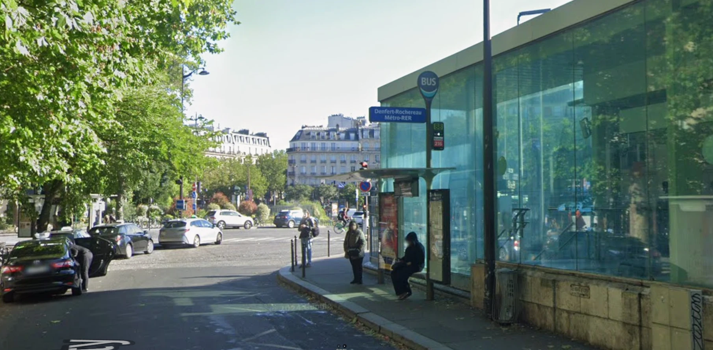

# 💀 The Silence Below — OSINT Writeup

**Category:** OSINT / Geolocation
**Flag:** `CYBTBR{Les_Catacombes_de_Paris}`

---

## Challenge

> The city above continues to breathe. Beneath it, millions have long since fallen silent.
>
> A photograph recovered from VEIL's abandoned records captures an ordinary place. A familiar sign. Passing strangers. Nothing particularly unusual.
>
> But some secrets are buried deeper than others.
>
> They say the darkness below holds the remains of nearly six million souls. Countless empty sockets stare into the silence, while forgotten stories linger in tunnels that tourists now dare to explore.
>
> Some visit out of curiosity. Others leave wondering what they might have disturbed.
>
> Find the place where the dead outnumber the living.
>
> Six million. Countless skulls. One secret beneath the streets.
>
> Flag Format: `CYBTBR{Name_of_the_Place}`

We are given a single street-level photo.



---

## Solution

### 1. Read the image

The photo shows a bus stop next to a glass-walled station building, with Haussmann-style apartment blocks in the background. That architecture already suggests Paris.

The blue sign on the bus stop post gives the exact location:

> **Denfert-Rochereau — Métro-RER**

So the photo was taken at **Place Denfert-Rochereau**, in the 14th arrondissement of Paris.

### 2. Match the clues

| Clue | Meaning |
|------|---------|
| "remains of nearly six million souls" | The Paris Catacombs hold the bones of about 6 million people |
| "countless skulls", "empty sockets" | The ossuary walls are lined with stacked skulls and bones |
| "tunnels that tourists now dare to explore" | The Catacombs are a popular tourist attraction |
| "the dead outnumber the living" | ~6 million dead below vs. ~2.1 million living residents of Paris |
| "one secret beneath the streets" | The tunnels run under the streets of southern Paris |

The tourist entrance to the Catacombs is at **1 Avenue du Colonel Henri Rol-Tanguy**, right on Place Denfert-Rochereau, a few steps from the station in the photo.

### 3. Build the flag

The English name (`Catacombs_of_Paris`) and several other variants were rejected. The flag uses the official French name, including the article **"Les"**:

```
CYBTBR{Les_Catacombes_de_Paris}
```

---

## Takeaways

- Signs in the photo (street, station and bus-stop signs) are often the fastest way to pin down a location.
- Story details like "six million souls" are strong clues to a specific landmark.
- If the place is right but the flag is rejected, try the **official local-language name** before giving up on the location.
