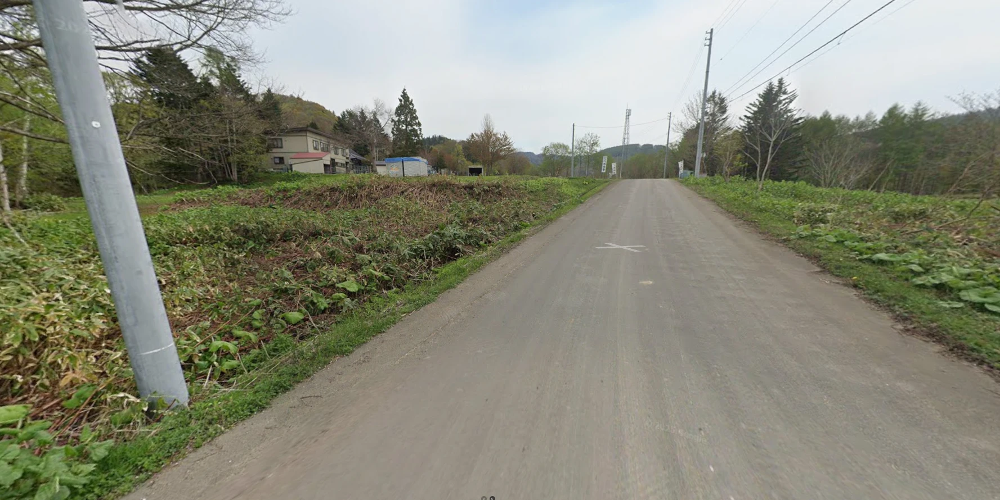
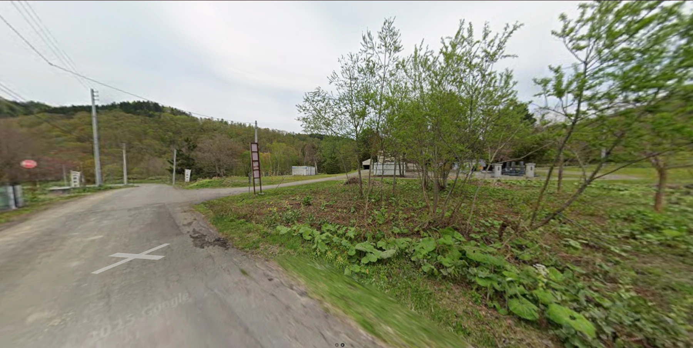

# 👁️ The Unsettling Gaze — OSINT Writeup

**Category:** OSINT / Geolocation
**Flag:** `CYBTBR{Eikichi_Suzuki}`

---

## Challenge

> Some things are buried because they are forgotten. Others are buried because nobody dares to remember them.
>
> A remote sanctuary stands quietly among the trees. Its surroundings appear peaceful, its grounds undisturbed. Yet, behind its silence lies a story that has unsettled those who have encountered it for generations.
>
> Whispers speak of something that was never supposed to move, yet seemed to possess a life of its own. Time passed. People came and went. But one question remained unanswered:
>
> Who was the person that brought it into this world of the living?
>
> VEIL has recovered a glimpse of the place, but the truth lies buried beneath layers of history, forgotten records, and unsettling accounts.
>
> Trace the location. Unearth its past. Find the identity of the person connected to its arrival.
>
> Some secrets refuse to stay buried.
>
> And some things never stop watching.
>
> Flag Format: `CYBTBR{Firstname_Familyname}`

We are given two Google Street View screenshots.





---

## Solution

### 1. Read the images

| Detail | What it tells us |
|--------|------------------|
| Concrete utility poles with step bolts, overhead lines | Typical of Japan |
| Large round butterbur (*fuki*) leaves along the road | Very common in Hokkaido |
| Birch, larch and spruce forest, low wooded hills | Northern, cool climate — Hokkaido |
| White standing signboards (*nobori*-style) by the road | Japanese temple/shrine entrance markers |
| Rows of dark stone gravestones in image 2 | A small temple cemetery |
| Small buildings set back among the trees | A rural temple compound |

So the "remote sanctuary among the trees" is a **small Buddhist temple with a graveyard in rural Hokkaido**.

### 2. Match the story

| Clue | Meaning |
|------|---------|
| "something that was never supposed to move, yet seemed to possess a life of its own" | A haunted object — a doll whose hair is said to grow on its own |
| "unsettled those who have encountered it for generations" | A legend going back about a century |
| "never stop watching" / "The Unsettling Gaze" | A doll's staring eyes |
| "Who was the person that brought it into this world" | The person who bought the doll and brought it home |

A haunted doll kept at a rural temple in Hokkaido points to one famous legend: the **Okiku doll** (お菊人形), kept at **Mannen-ji** (萬念寺) in Kurisawa, Iwamizawa, Hokkaido. The temple grounds and cemetery match the Street View images.

### 3. The legend

- In **1918**, a 17-year-old named **Eikichi Suzuki** (鈴木永吉) bought a Japanese doll in Sapporo while visiting a marine exhibition.
- He gave it to his 2-year-old sister, **Kikuko**, who loved it. The doll became known as "Okiku".
- Kikuko died young, and the family kept the doll at their home altar. They said its hair began to grow, and believed her spirit lived in it.
- In **1938** the Suzuki family moved to Sakhalin and left the doll with **Mannen-ji**, where it is still kept. The temple trims its hair from time to time.

So the person who brought the doll "into this world of the living" is **Eikichi Suzuki**.

### 4. Build the flag

Format is `Firstname_Familyname` (Western order):

```
CYBTBR{Eikichi_Suzuki}
```

---

## Takeaways

- Vegetation and infrastructure narrow things down fast: concrete poles + butterbur + birch/larch forest = rural Hokkaido.
- Story clues ("never supposed to move", "never stop watching") point to a known legend; find the legend first, then confirm the place.
- When the flag asks for `Firstname_Familyname`, put Japanese names in Western order (given name first).
