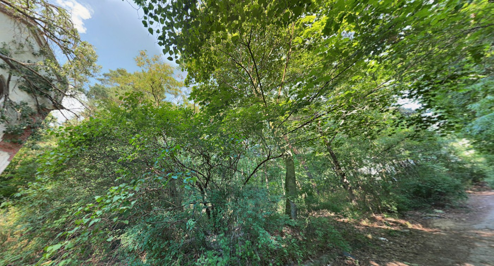
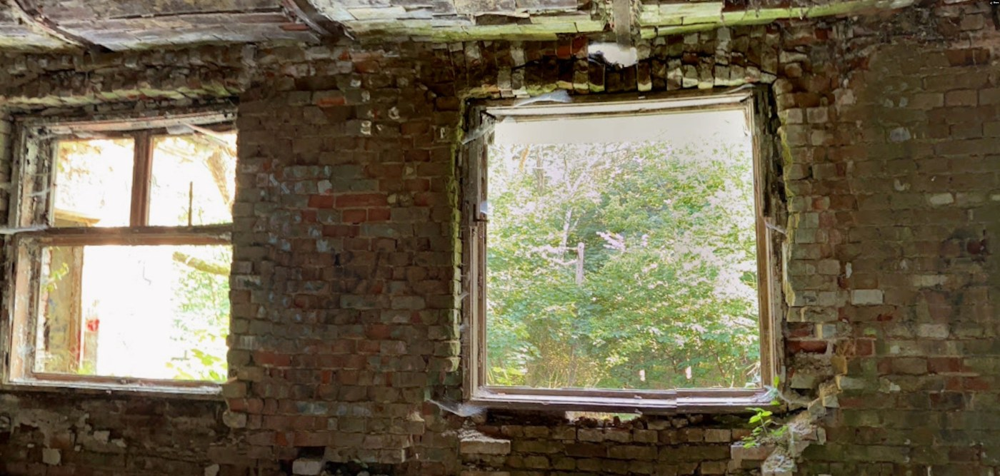
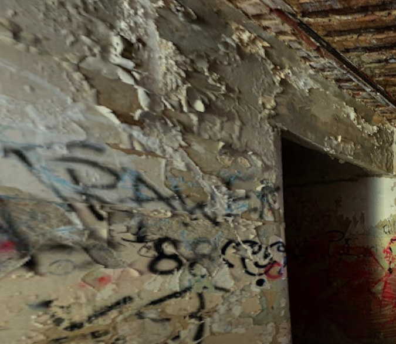
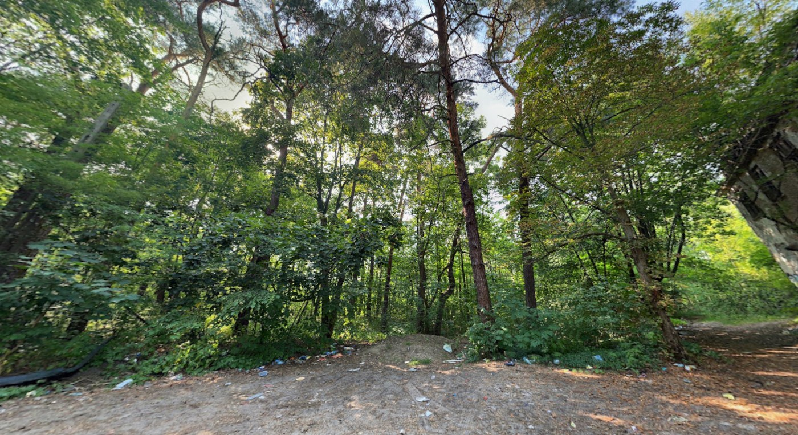
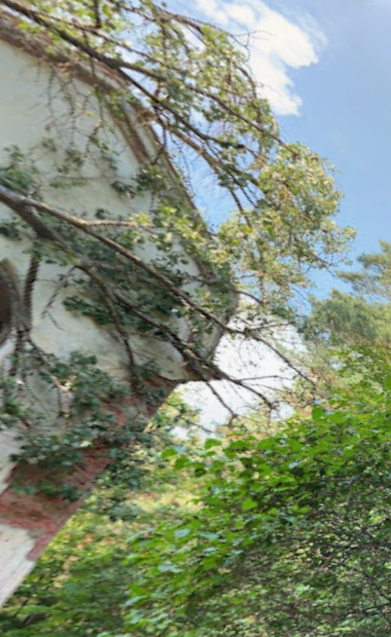

# 🏚️ Where the Walls Remember — OSINT Writeup

**Category:** OSINT / Geolocation
**Flag:** `CYBTBR{Zofiówka_Sanatorium}`

---

## Challenge

> There are places where silence feels heavier than it should.
>
> Hidden beneath overgrown trees, forgotten pathways lead to the remains of a place that once stood for a very different purpose. Its corridors have fallen silent, its windows stare into empty rooms, and nature is slowly reclaiming what humanity left behind.
>
> But abandonment does not always mean peace.
>
> Stories of suffering, unexplained events, and a troubled past linger around these forgotten walls. What once welcomed people seeking refuge eventually became a place many would rather forget.
>
> VEIL has recovered several visual fragments from this location. No address. No coordinates. Only traces of a forgotten past.
>
> Identify the place. Investigate its history. Uncover the name hidden behind these decaying walls.
>
> Some buildings are abandoned. Their stories are not.
>
> *Flag Format:* `CYBTBR{Place_Name}`

We are given four images, with no metadata:

| | |
|---|---|
|  |  |
|  |  |

---

## Solution

### 1. Read the images

| Image | Detail | What it tells us |
|-------|--------|------------------|
| 1 | Corner of a building with an **arched window**, **white plaster peeling off red brick**, swallowed by trees | Early 20th-century European masonry building, long abandoned |
| 2 | Bare brick walls, **double wooden box windows** | Typical of Central/Eastern Europe (cold-climate double glazing) |
| 3 | Graffiti, flaking plaster, a ceiling of **brick arches between steel beams** | A "Prussian vault" (*Kappendecke*), common in Germany and Poland around 1880–1930 |
| 4 | Dirt path through **mixed pine and deciduous forest**, a large grey building at the edge | A complex hidden in woodland |



So: an abandoned, graffiti-covered institution from around 1900, in a pine forest in Germany or Poland.

### 2. Match the story

| Clue | Meaning |
|------|---------|
| "once stood for a very different purpose" | Not a home or factory, but an institution |
| "welcomed people seeking refuge" | A sanatorium or asylum, a place people came to for care |
| "stories of suffering… a troubled past" | Something terrible happened there |
| "a place many would rather forget" | A dark chapter of history |

### 3. Narrow it down

Reverse image searches (Google Lens, Yandex) give mostly look-alikes, such as Beelitz-Heilstätten near Berlin and other "lost places". Beelitz fits the architecture but not the story, and its name is rejected as a flag.

Combining the architecture, the pine forest and "refuge… suffering" leads to **Zofiówka** in **Otwock, Poland**:

- Founded in **1908** with donations from Zofia Endelman, as a **sanatorium for Jewish patients with nervous and mental illnesses**, a place of refuge and care.
- During the Second World War it became part of the **Otwock Ghetto**. Around **400 patients starved to death** there, and the rest died when the ghetto was liquidated in 1942.
- After the war it was used as a TB clinic and an addiction treatment centre, and it was **abandoned in the 1990s**.
- Today it is a set of graffiti-covered, white-plastered brick buildings with arched windows, overgrown by pine forest. It is a well-known "haunted" urbex spot.

Comparing photos of Zofiówka (search "Zofiówka Otwock ruiny") with the challenge images shows the same style: white plaster over red brick, arched windows, graffiti interiors and pine woods.

### 4. Build the flag

The official name is **Zofiówka Sanatorium**. The flag needs the Polish letter **ó**. `Zofiowka_Sanatorium` without the accent is rejected:

```
CYBTBR{Zofiówka_Sanatorium}
```

---

## Takeaways

- Construction details narrow down the region: Prussian vault ceilings and double box windows point to Central/Eastern Europe.
- Reverse image search on ruins mostly returns look-alikes. Use the story ("refuge", "suffering") to pick between them.
- "Refuge" in a challenge about an abandoned building usually means a sanatorium, asylum or hospital.
- Keep **diacritics** in place names. Here `ó` was required.
