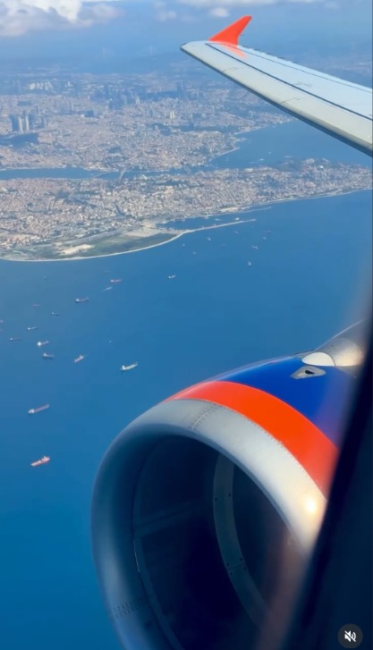
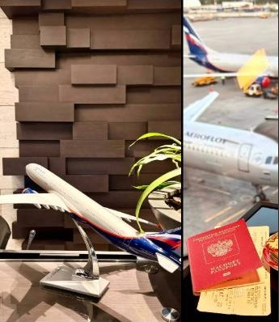
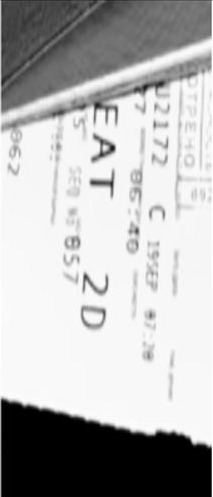

# ✈️ Window Seat — OSINT Writeup

**Category:** OSINT / Social Media
**Flag:** `CYBTBR{2D}`

---

## Challenge

> A strange trace has emerged from the digital shadows.
>
> An aircraft window photograph has surfaced, capturing what appears to be an ordinary moment above the clouds. Yet, this image holds a connection to something hidden elsewhere on the internet.
>
> VEIL has left behind another fragmented trail. The photograph may lead you to a social media profile, but the real secret isn't necessarily in the image itself. Somewhere within its digital footprint, another piece of information holds the key to what you're looking for.
>
> Your objective is to investigate the image, trace it back to its source, explore the associated online presence, and uncover the passenger's seat number.
>
> Sometimes, the answer isn't hidden in the evidence you're given, but somewhere along the trail it leads you to.
>
> *Can you follow the trail and uncover what VEIL has left behind?*
>
> Flag Format: `CYBTBR{...}`

We are given `window_seat.png`:



---

## Solution

### 1. Read the image

| Detail | What it tells us |
|--------|------------------|
| Engine nacelle with blue and orange stripes, orange winglet | **Aeroflot** livery (A320 family) |
| City on two shores, a strait full of anchored ships | **Istanbul** and the Bosphorus |
| Mute icon in the bottom-right corner | A screenshot of an **Instagram Reel** |

So it's an Aeroflot flight approaching Istanbul, filmed for Instagram.

### 2. Find the source

A reverse image search (Google Lens) on the screenshot finds the original Reel: a 30-second window video posted on **19 September 2026** by a personal Instagram account. The Reel itself has no caption, no comments and no seat information, so the challenge's hint applies: *"the real secret isn't necessarily in the image itself."*

### 3. Check the rest of the trip

Instagram only shows a profile's newest posts at first, so scroll the profile's **Reels** tab back to 19 September. The same day has another Reel posted just **before** the flight video, filmed at **Sheremetyevo Airport, Moscow**. It shows the terminal's globe display, an Aeroflot model plane, the apron, and at the end a Russian passport with **boarding passes** next to a glass of tea:



### 4. Read the boarding pass

Step through the Reel frame by frame (pause it and seek in the browser, or download it and use a video player). Around 4–5 seconds in, the pass is flat and in focus. Zoomed and contrast-boosted, it reads:



| Field | Value |
|-------|-------|
| Flight | **SU2172** (Aeroflot) |
| Route | Moscow SVO (Terminal C) → Istanbul IST |
| Class | C (business) |
| Date | 19 SEP |
| **Seat** | **2D** |

The passenger's name is on the pass too. It isn't needed for the flag, so it's left out here.

### 5. Build the flag

```
CYBTBR{2D}
```

---

## Takeaways

- The provided image is often only the entry point. Here the seat number was in a **different post** from the same trip, not in the screenshot or its source Reel.
- UI elements in a screenshot (the Reels mute icon) tell you which platform to search.
- When a profile only loads its newest posts, scroll the **Reels** tab with real scrolling. Instagram loads older posts in batches.
- Travel posts often show boarding passes. Pause videos and zoom in on single frames. Passes include the flight, route, class and seat.
- Redact personal details such as names and ticket numbers when writing up.
