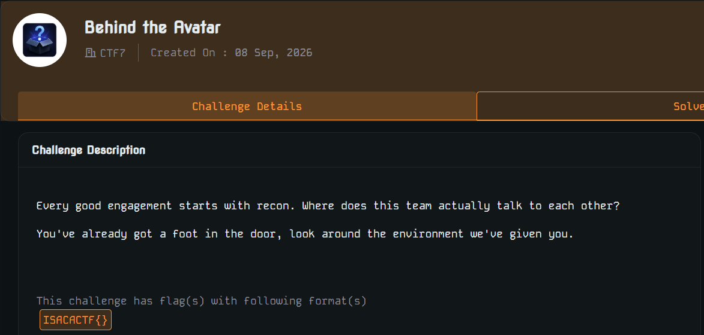
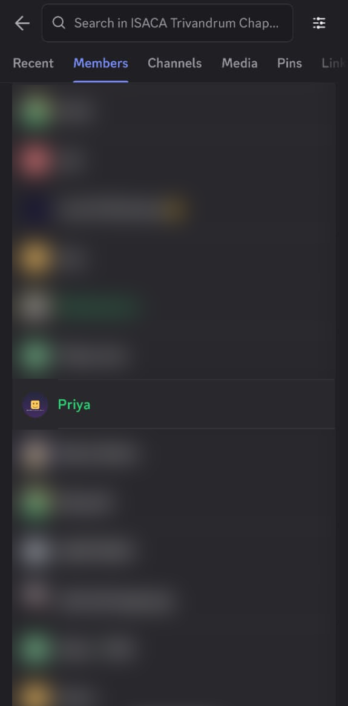
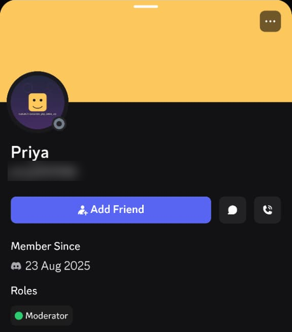
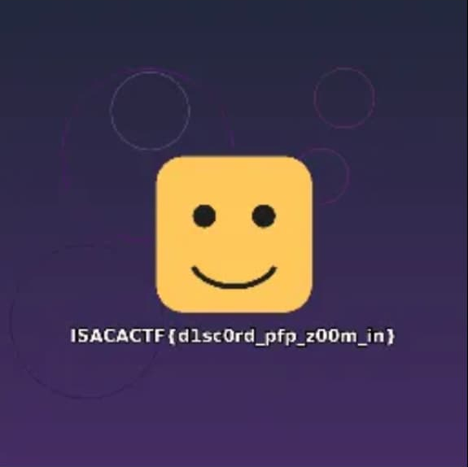

# Behind the Avatar — ISACA CTF Writeup

| | |
|---|---|
| **Event** | ISACA Trivandrum Chapter CTF (2026) |
| **Challenge** | Behind the Avatar |
| **Category** | OSINT / Recon |
| **Difficulty** | Easy (it didn't feel easy at the time 😅) |
| **Flag format** | `ISACACTF{}` |

> This is my first writeup, and also my first solve.

---

## Background

This was the first CTF I've ever played. It had challenges in web, network, forensics, OSINT and more. Out of all of them, **"Behind the Avatar"** caught my eye.

It turned out to be an easy challenge, but it was a nightmare for me.

## The Challenge



> *Every good engagement starts with recon. Where does this team actually talk to each other?*
> *You've already got a foot in the door, look around the environment we've given you.*

## What I Tried First (and Got Wrong)

The title says the answer is **behind the avatar**, so I stared at the challenge's own icon on the CTF platform and assumed the flag was hidden there.

- I inspected the page elements in browser DevTools
- I dug through everything I could find in the browser
- I clicked around the rest of the CTF website

None of it worked, and I nearly gave up.

## The Breakthrough

Then I re-read the hint:

> *"Where does this team **actually talk** to each other?"*

I had checked the website, but **not the Discord server**. The "foot in the door" was the event's Discord, which every participant had already joined.

### Step 1: Go through the server members

In the Discord server I opened **Members** and went through the people with roles. One of them looked like it shouldn't be there:



*(I blurred the other members' names and avatars because they have nothing to do with the challenge.)*

The member **Priya** had a profile picture with something written underneath it in tiny text.

### Step 2: Open the profile



Priya has the **Moderator** role, and the avatar clearly has a line of text below the smiley face. It's too small to read at this size.

### Step 3: Zoom in on the avatar

When you tap the profile picture, Discord opens it at full size:



And there was the flag, literally **behind the avatar**. 🎉

## Flag

```
ISACACTF{d1sc0rd_pfp_z00m_in}
```

## What I Learned

1. **Read the hint, not just the title.** The title said "avatar". The hint said *where the team talks*. I chased the title and ignored the hint.
2. **The scope is bigger than the website.** In OSINT challenges, the "environment we've given you" can include the event's Discord, socials and other community spaces.
3. **Look at roles and profiles.** Members with roles like Moderator are worth checking. CTF authors like to hide things in bios, avatars and banners.
4. **Zoom in.** Avatars are shown very small. Always open the full-size image.

---

All this hard work for Priya <3 :)
